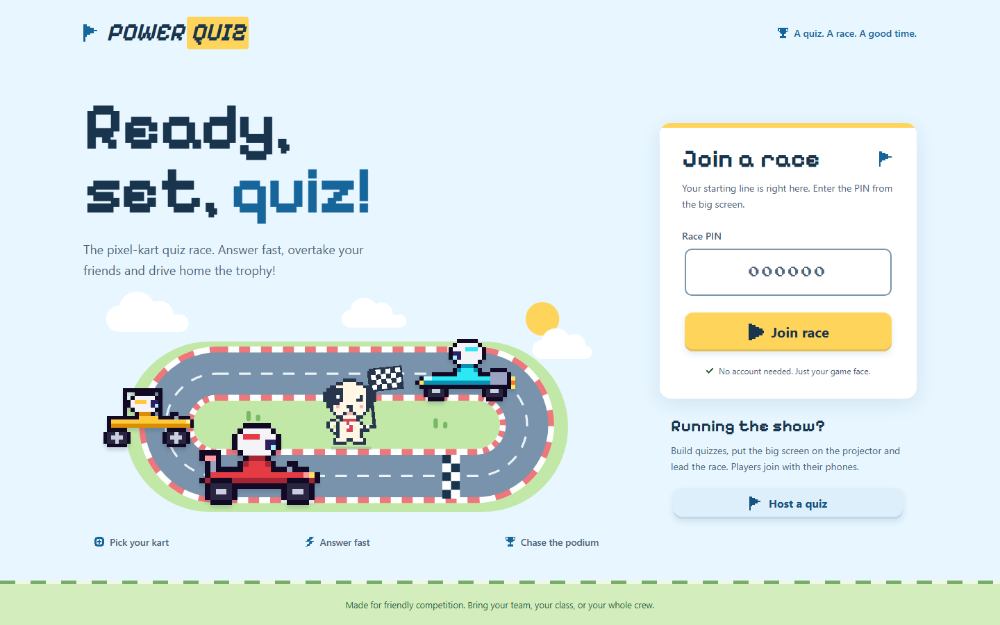
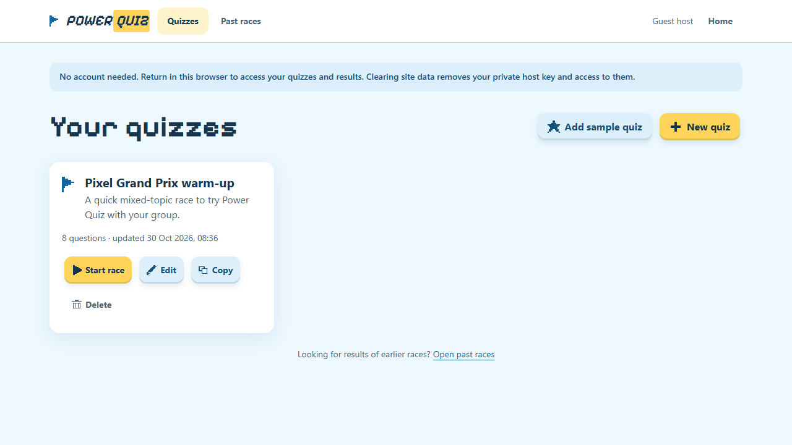

# Power Quiz 🏁

Live quiz races with a sunny pixel-art kart twist – think Kahoot, but every player drives a kart.
A **host** builds quizzes and runs the race on a big shared screen; **players** join from their phones
with a QR code or PIN, pick a nickname and a kart, and race to the podium by answering fast.
**No account is needed for hosts or players by default.**



| Guest workspace with the sample quiz                                                       | Quiz editor                                                             | Final podium                                                            |
| ------------------------------------------------------------------------------------------ | ----------------------------------------------------------------------- | ----------------------------------------------------------------------- |
|  |  |  |

| Lobby with QR code                                     | Answer reveal                                      | Race-track standings                                         |
| ------------------------------------------------------ | -------------------------------------------------- | ------------------------------------------------------------ |
|  |  |  |

| Phone: question                                                                   | Phone: result                                                                          |
| --------------------------------------------------------------------------------- | -------------------------------------------------------------------------------------- |
|  |  |

These are screenshots of the running guest-mode app with demo quizzes and racers. The pictured PINs and
local join addresses are examples, not active races.

## Features

- **No account needed to host** – open the host workspace and start creating. A private browser key keeps
  your quizzes, results and race controls separate from everyone else's. Microsoft Entra ID sign-in remains
  an opt-in deployment mode.
- **Sample quiz included** – **Add sample quiz** creates your own editable copy of **Pixel Grand Prix
  warm-up**: six multiple-choice questions and two open questions, ready to run.
- **A pixel-dog referee** – a cute, chunky cartoon pup with black ears and a small striped red tie greets racers by the
  circuit, joins the countdown and waves a chequered flag at the podium. His short tail-wag, blink and flag
  animations respect reduced-motion preferences.
- **Reusable quizzes** – multiple-choice questions (2–4 answers, one correct) and open questions, each with its
  own time limit (5–120 s). Add, reorder, duplicate and delete questions; start a race straight from the editor.
- **Join in seconds** – players scan the QR code or type the 6-digit PIN, choose a nickname and one of
  6 kart models × 8 colours. No account needed. Late joiners can hop in until the lead locks the race.
- **The lead controls the pace** – start the race, end questions early, move on when ready. A question also
  closes automatically when the timer runs out or every connected player has answered.
- **Big-screen moments** – traffic-light countdown, live answer counter, answer bars with the correct answer
  popping up, an answer wall for open questions (with nicknames), karts racing forward on the standings,
  and a podium with confetti plus the full hitlist at the end.
- **Kahoot-style scoring** – a correct answer earns 500–1000 points depending on speed. Open questions are not
  scored; they're shown for discussion.
- **Personal feedback on phones** – correct/wrong, points, current position and the gap to the kart ahead.
- **Resilient** – phones that lose the connection or reload rejoin automatically with name, kart and score.
- **Moderation** – profanity filter for nicknames and open answers, kick players, hide answers on the big screen.
- **Results history** – every race is stored for 90 days with per-question statistics and CSV export.
- **Retro sound** – original chiptune music and sound effects on the big screen only (mute with `M`).

The light circuit theme uses original pixel karts, checkered curbs, sky-blue surfaces and
high-contrast pastel answers. The garage supports keyboard selection, and spatial effects respect
reduced-motion preferences.

## How a race works

```
Lobby (QR + PIN) → [Start] → traffic-light countdown → question (timer)
   → reveal (answer stats / answer wall) → standings (multiple choice only) → … next question …
   → podium + hitlist → finished (results saved, CSV export)
```

Keyboard shortcuts on the big screen: **Space** next · **E** end question · **L** lock/unlock · **M** mute ·
**F** fullscreen.

## Quick start (local)

Prerequisites: **Node.js 24** (see `.nvmrc`).

```sh
npm install
npm run dev
```

- Open <http://localhost:5173> for the app (Vite dev server; the API runs on port 3000 behind a proxy).
- Click **Host a quiz** – there is no name, account or sign-in step.
- Click **Add sample quiz** to create **Pixel Grand Prix warm-up** (8 questions), then **Start race**.
- Join from a second browser window with the PIN shown on the big screen.
- To join with real phones on the same Wi-Fi, run `npm run dev:lan` instead and open the big screen via the
  `Network:` URL that Vite prints (e.g. `http://192.168.1.20:5173`) – the QR code points to the address the big
  screen was opened with.

Without configuration the server keeps everything **in memory**. To persist data locally, run the Cosmos DB
emulator (`docker compose up -d`) and set the variables from [`.env.example`](.env.example) in a `.env` file.

To try the production build locally: `npm run build && npm start` → <http://localhost:3000>.

### Your private host workspace

On your first visit to a host page, the browser generates a cryptographically random 256-bit host key and
saves it in local storage. The API and live controls use that key; the server derives a one-way hashed owner
ID so it never needs to save the key itself. Player PINs, race links and player rejoin tokens do **not** grant
host access.

Return using the **same browser profile and site address** to find your quizzes and results, including after
a reload or in another tab. The content is stored on the server, not in local storage; the browser holds only
the key to it. Clearing site data, changing browsers or closing a private-browsing session removes access.
There is no account recovery or cross-device sync in guest mode. If browser storage is unavailable, hosting
shows an error rather than silently creating a temporary workspace.

## Scripts

| Command             | What it does                                                                  |
| ------------------- | ----------------------------------------------------------------------------- |
| `npm run dev`       | API (tsx watch, port 3000) + web app (Vite, port 5173)                        |
| `npm run dev:lan`   | Same, but the web app is reachable from other devices on your network         |
| `npm run build`     | Builds the SPA and the bundled server and assembles the deployable `.deploy/` |
| `npm start`         | Runs the production bundle from `.deploy/`                                    |
| `npm test`          | Unit and integration tests (Vitest) for all workspaces                        |
| `npm run test:e2e`  | Playwright end-to-end tests against `.deploy/` (run `npm run build` first)    |
| `npm run lint`      | ESLint                                                                        |
| `npm run typecheck` | TypeScript checks for all workspaces                                          |
| `npm run format`    | Prettier                                                                      |
| `npm run load-test` | Simulates a race with many phones ([Capacity and cost](#capacity-and-cost))   |

The Cosmos DB repository tests run only when `COSMOS_TEST_ENDPOINT` is set, e.g. against the emulator:
`COSMOS_TEST_ENDPOINT=http://localhost:8081 npx vitest run --project server test/cosmos.test.ts`.

### Refreshing the screenshots

The README gallery uses real browser captures of the production build in guest mode, including the
starting page, sample-quiz workspace, editor, race stages and phone feedback. To capture a fresh set in
PowerShell:

```powershell
npm run build
$env:E2E_SCREENSHOTS_DIR = Join-Path $env:TEMP 'power-quiz-screenshots'
npm run test:e2e
```

The capture helper waits for fonts and disables animations for stable images. Long pages get both a
full-page image and a `-viewport.png` version. Update the gallery files in `docs/screenshots` from those
captures; use the editor's viewport image so its fixed controls are shown in context.

## Configuration

All settings are environment variables (validated at startup):

| Variable                      | Default       | Description                                                                |
| ----------------------------- | ------------- | -------------------------------------------------------------------------- |
| `PORT`                        | `3000`        | HTTP port                                                                  |
| `NODE_ENV`                    | `development` | `production` enables production security headers and refuses dev sign-in   |
| `LOG_LEVEL`                   | `info`        | pino log level                                                             |
| `AUTH_MODE`                   | `guest`       | `guest` (no login), `entra` (explicit opt-in), or `dev` (local only)       |
| `ENTRA_TENANT_ID`             | –             | Tenant of the leads (single tenant)                                        |
| `ENTRA_CLIENT_ID`             | –             | App registration (SPA + exposed API)                                       |
| `ENTRA_API_SCOPE_NAME`        | `Quiz.Host`   | Delegated scope required in access tokens                                  |
| `COSMOS_ENDPOINT`             | – (in-memory) | Cosmos DB endpoint; uses managed identity / your Entra login without a key |
| `COSMOS_KEY`                  | –             | Only for the local emulator                                                |
| `COSMOS_DATABASE`             | `powerquiz`   | Database name                                                              |
| `COSMOS_CREATE_IF_NOT_EXISTS` | `false`       | Create database/containers at startup (emulator only)                      |
| `RESULT_TTL_DAYS`             | `90`          | How long race results are kept                                             |
| `TRUST_PROXY`                 | `0`           | Reverse-proxy hops to trust for client IPs (`1` on App Service)            |
| `STATIC_DIR`                  | auto          | Folder with the built web app                                              |

## Architecture

```
  Phones (players)                         Big screen (lead, private host key)
  React SPA ──────────┐               ┌─── React SPA (MSAL only in Entra mode)
                      │  HTTPS + WSS  │   (REST /api + Socket.IO, bearer token)
                      ▼               ▼
        Azure App Service (Linux P0v3, Node.js 24, single instance)
          Express 5  – REST API: quizzes, sessions, results, CSV, runtime config
          Socket.IO  – realtime gateway → game engine (in-memory state machine + timers)
          Static hosting of the SPA build (same origin, no CORS)
                      │ managed identity (no keys)
                      ▼
        Azure Cosmos DB (serverless): quizzes · sessions · sessionAnswers
        Application Insights + Log Analytics
```

- The **server is authoritative**: it runs the timers, measures response times on its own clock, scores
  answers and never sends the correct answer to anyone before a question closes.
- Clients receive full **view snapshots** (`host:view`, `player:view`) after every change, so a reconnect simply
  restores the current state. Bursts of changes are coalesced into one update.
- Live game state is kept **in memory**: one P0v3 instance runs races of up to 400 players (see
  [Capacity and cost](#capacity-and-cost)). Results are written to Cosmos DB after each question and at the
  end. A restart or redeploy during a live race ends that race.

```
apps/web          React 19 + Vite SPA: phone flow, big screen, quiz editor, results
apps/server       Express + Socket.IO server, game engine, Cosmos DB repositories
packages/shared   Types, zod schemas, socket contracts, scoring rules (used by both)
infra/            Bicep modules + azd hooks (optional Entra ID app registration)
e2e/              Playwright end-to-end tests
```

## Deploy to Azure

### Prerequisites

- Node.js 24 and [Azure Developer CLI](https://aka.ms/azd) (plus PowerShell 7 on Windows).
- An Azure subscription where you can create resource groups and resources (Contributor or Owner).
- Sign in to Azure for deployment (this is separate from hosting quizzes):
  ```sh
  azd auth login
  ```

### Provision and deploy

```sh
azd up   # asks for an environment name, subscription and region (e.g. germanywestcentral)
```

`azd up` provisions `rg-<env>`: App Service (Linux, P0v3), serverless Cosmos DB, Log Analytics and Application
Insights, then builds the app (`npm run build` → `.deploy/`) and deploys it. Guest hosting is the default:
there is **no Entra app registration, redirect URI or Microsoft host sign-in to configure**.
Afterwards use `azd deploy` (code only) or `azd provision` (infrastructure only). Your user gets Cosmos DB
data access; use `COSMOS_ENDPOINT` from `azd env get-values` and your Azure credentials to run locally
against Azure.

To switch an existing Entra deployment to guest hosting, run `azd env set AUTH_MODE guest` followed by
`azd up`, so both the App Service settings and application code are updated.

### Capacity and cost

A race holds up to **400 players**, which leaves room for 300 racers plus phones that join a second time.
Every phone keeps a WebSocket open, so the default plan is **P0v3** (1 vCPU, 4 GB RAM): Premium plans have no
WebSocket connection limit, whereas Basic plans (B1–B3) allow at most 350 concurrent WebSockets per instance.
On P0v3, simulated 300- and 400-player races counted every answer, delivered each question to all phones within
0.2 s and kept the CPU below 25%.

A month of the P0v3 plan costs about **€57** (pay-as-you-go list price in Sweden Central and Germany West
Central, October 2026). Serverless Cosmos DB and the logs add only cents for typical use. `azd down` deletes
everything when the event is over. For small groups, choose a cheaper plan before provisioning:

```sh
azd env set APP_SERVICE_PLAN_SKU B1   # about €12/month, at most 350 concurrent WebSockets
azd provision
```

If provisioning fails with `SubscriptionIsOverQuotaForSku` (for example `Current Limit (P0v3 VMs): 0`), the
subscription has no App Service quota for that plan in the region. Request a quota increase, or move to a region
with quota: run `azd down`, then `azd env set AZURE_LOCATION swedencentral` and `azd up`.

Before an event, simulate a full race against the deployment:

```sh
npm run load-test -- https://<app>.azurewebsites.net --players 300
```

It connects the given number of simulated phones, answers every question, checks the saved results and then
deletes its quiz and results again. Your machine receives the updates of every simulated phone, so on a slow
connection racers may drop while joining; lower `--join-concurrency` (default 10, e.g. `3`) in that case. Run
it before, not during, a real race, and avoid deployments (`azd deploy`, or merges to `main` with CI/CD) while a
race is live: a restart ends live races.

### Optional Microsoft Entra ID sign-in

For a deployment that requires organizational accounts instead, explicitly set `AUTH_MODE=entra`.
This also requires the [Azure CLI](https://aka.ms/install-azure-cli) and permission to **register applications**
in the sign-in tenant. Sign the CLIs in to the same tenant, then provision:

```sh
az login --tenant <tenant-id-or-domain>
azd auth login --tenant-id <tenant-id>
azd env set AUTH_MODE entra
azd up
```

Only in this mode, the hooks create or reuse "Power Quiz (&lt;env&gt;)" (SPA + API scope `Quiz.Host`) and add
the site URL as a redirect URI. Local Entra runs also require `AUTH_MODE=entra`, `ENTRA_CLIENT_ID` and
`ENTRA_TENANT_ID`; having the IDs alone does not enable sign-in. `azd down` does not delete the optional app
registration (`az ad app delete --id <ENTRA_CLIENT_ID>`).

Guest keys and Entra accounts have separate ownership. Changing modes does not delete, share or migrate
existing quizzes and results; switch back to the original mode and identity to access them.

### CI/CD with GitHub Actions

- `.github/workflows/ci.yml` runs formatting, lint, typecheck, unit/integration tests, the build and the
  Playwright end-to-end tests on every pull request and push to `main`.
- `.github/workflows/deploy.yml` provisions and deploys with azd after CI succeeds on `main` (or manually).
  Set it up once with:

```sh
azd pipeline config   # optionally: --principal-role Contributor (no other role is needed)
```

This creates a federated (OIDC) service principal and sets the repository variables `AZURE_CLIENT_ID`,
`AZURE_TENANT_ID`, `AZURE_SUBSCRIPTION_ID`, `AZURE_ENV_NAME` and `AZURE_LOCATION`. The deploy workflow defaults
to guest hosting and needs no `ENTRA_*` variables. It provisions the P0v3 plan unless the repository variable
`APP_SERVICE_PLAN_SKU` (copied from your azd environment when set) names another one. For an Entra deployment,
also set the repository variables `AUTH_MODE=entra`, `ENTRA_CLIENT_ID` and `ENTRA_TENANT_ID` (exported by
`azd pipeline config` when configured).
CI never creates or changes an Entra ID app registration.

## Security & privacy

- Guest hosting is open to anyone, but each browser's private key grants access only to its own quizzes and
  races. The API and Socket.IO handshake require this key; only its hash is stored as the owner ID. Keep the
  key private and serve public deployments over HTTPS. Anyone using the same browser profile can access its
  guest workspace; it is not suitable for confidential content on a shared computer.
- In optional Entra mode, the API and Socket.IO handshake validate access tokens (signature, issuer, tenant,
  audience and the `Quiz.Host` scope). Leads only ever see their own quizzes and races in either mode.
- Players get an unguessable per-race token for rejoining; wrong PIN guesses are rate-limited per IP.
- Every input is validated with zod; nicknames are unique per race; CSV exports are protected against formula
  injection; strict security headers (CSP, HSTS, …) are set; Cosmos DB key access is disabled in Azure.
- Players see a privacy note when joining: nicknames, karts and answers appear on the big screen and are stored
  with the race results for 90 days (configurable). Leads can delete results at any time.

## Credits

All pixel art (karts, icons) and all music and sound effects are original and generated in code – no
third-party game assets. Fonts: [Press Start 2P](https://fonts.google.com/specimen/Press+Start+2P) and
[Pixelify Sans](https://fonts.google.com/specimen/Pixelify+Sans) (SIL Open Font License), self-hosted via
Fontsource.
