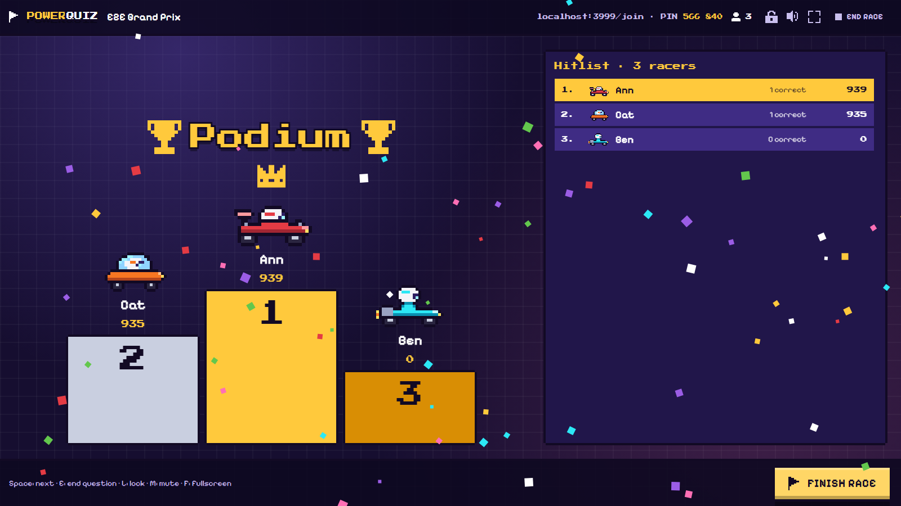
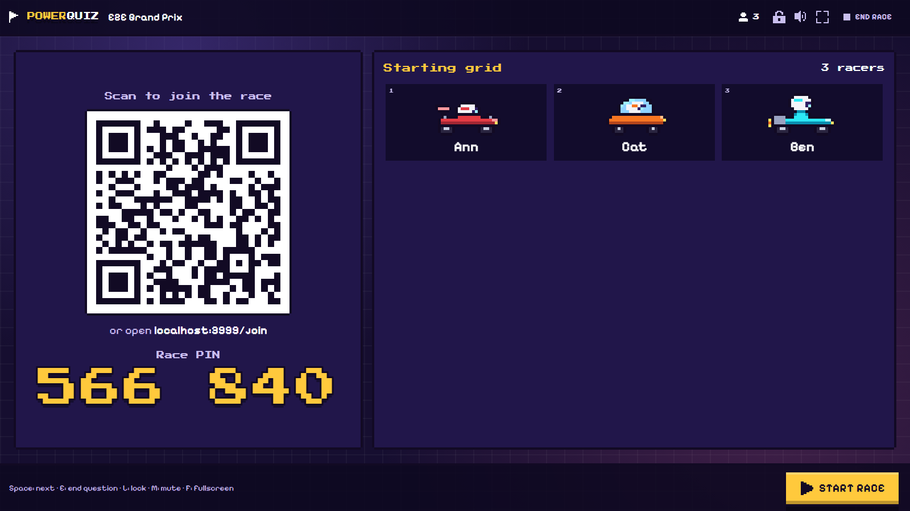
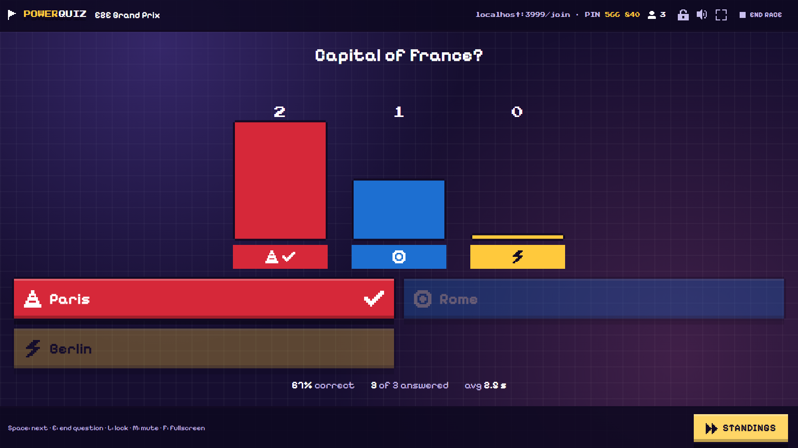
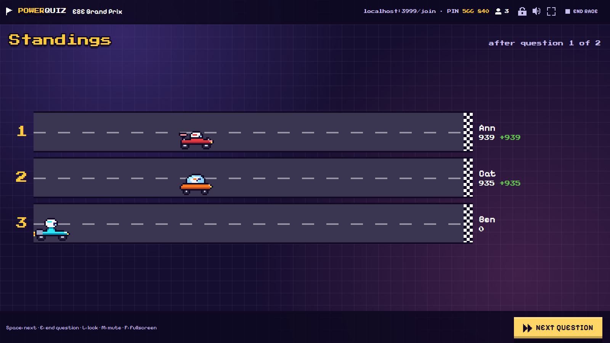
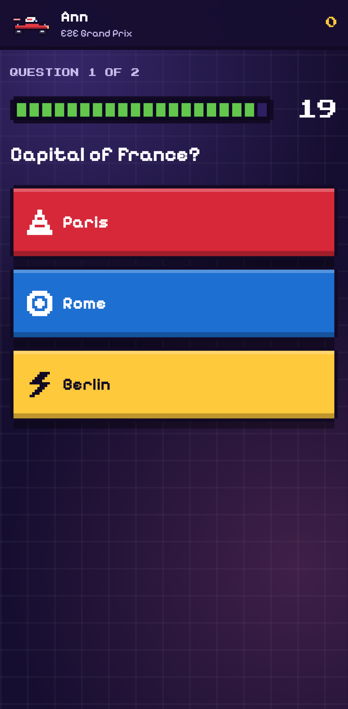
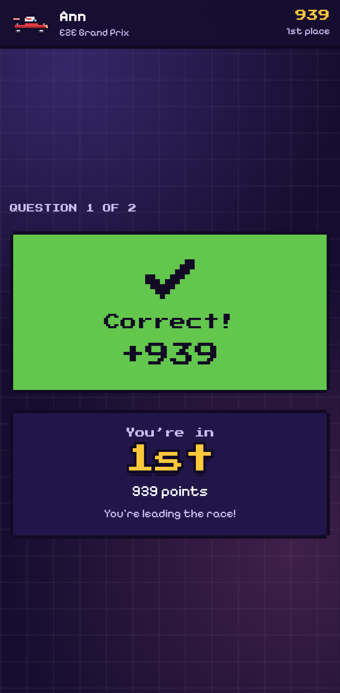
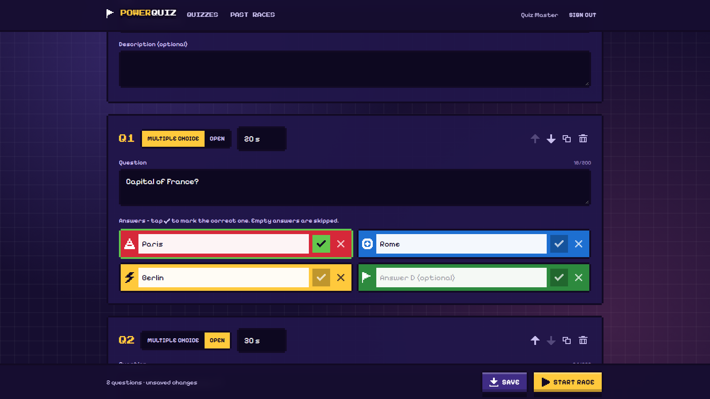

# Power Quiz 🏁

Live quiz races with a pixel-art kart twist – think Kahoot, but every player drives a kart.
A **session lead** builds quizzes and runs the race on a big shared screen; **players** join from their phones
with a QR code or PIN, pick a nickname and a kart, and race to the podium by answering fast.



| Lobby with QR code                                     | Answer reveal                                      | Race-track standings                                         |
| ------------------------------------------------------ | -------------------------------------------------- | ------------------------------------------------------------ |
|  |  |  |

| Phone: question                                        | Phone: result                                       | Quiz editor                                      |
| ------------------------------------------------------ | --------------------------------------------------- | ------------------------------------------------ |
|  |  |  |

## Features

- **Reusable quizzes** – multiple-choice questions (2–4 answers, one correct) and open questions, each with its
  own time limit (5–120 s). Add, reorder, duplicate and delete questions; start a race straight from the editor.
- **Join in seconds** – players scan the QR code or type the 6-digit PIN, choose a nickname and one of
  6 kart models × 8 colours. No account needed. Late joiners can hop in until the lead locks the race.
- **The lead controls the pace** – start the race, end questions early, move on when ready. A question also
  closes automatically when the timer runs out or every connected player has answered.
- **Big-screen moments** – traffic-light countdown, live answer counter, answer bars with the correct answer
  popping up, an answer wall for open questions (with nicknames), karts racing forward on the standings,
  and a podium with confetti plus the full hitlist at the end.
- **Kahoot-style scoring** – a correct answer earns 500–1000 points depending on speed. Open questions are not
  scored; they're shown for discussion.
- **Personal feedback on phones** – correct/wrong, points, current position and the gap to the kart ahead.
- **Resilient** – phones that lose the connection or reload rejoin automatically with name, kart and score.
- **Moderation** – profanity filter for nicknames and open answers, kick players, hide answers on the big screen.
- **Results history** – every race is stored for 90 days with per-question statistics and CSV export.
- **Retro sound** – original chiptune music and sound effects on the big screen only (mute with `M`).
- **Sign-in with Microsoft Entra ID** for session leads (single tenant).

## How a race works

```
Lobby (QR + PIN) → [Start] → traffic-light countdown → question (timer)
   → reveal (answer stats / answer wall) → standings (multiple choice only) → … next question …
   → podium + hitlist → finished (results saved, CSV export)
```

Keyboard shortcuts on the big screen: **Space** next · **E** end question · **L** lock/unlock · **M** mute ·
**F** fullscreen.

## Quick start (local)

Prerequisites: **Node.js 24** (see `.nvmrc`).

```sh
npm install
npm run dev
```

- Open <http://localhost:5173> for the app (Vite dev server; the API runs on port 3000 behind a proxy).
- Click **Host sign-in** – locally you sign in with just a name (dev mode, no real authentication).
- Use **Add sample quiz** for a ready-made quiz, then **Start race**.
- Join from a second browser window with the PIN shown on the big screen.
- To join with real phones on the same Wi-Fi, run `npm run dev:lan` instead and open the big screen via the
  `Network:` URL that Vite prints (e.g. `http://192.168.1.20:5173`) – the QR code points to the address the big
  screen was opened with.

Without configuration the server keeps everything **in memory**. To persist data locally, run the Cosmos DB
emulator (`docker compose up -d`) and set the variables from [`.env.example`](.env.example) in a `.env` file.

To try the production build locally: `npm run build && npm start` → <http://localhost:3000>.

## Scripts

| Command             | What it does                                                                  |
| ------------------- | ----------------------------------------------------------------------------- |
| `npm run dev`       | API (tsx watch, port 3000) + web app (Vite, port 5173)                        |
| `npm run dev:lan`   | Same, but the web app is reachable from other devices on your network         |
| `npm run build`     | Builds the SPA and the bundled server and assembles the deployable `.deploy/` |
| `npm start`         | Runs the production bundle from `.deploy/`                                    |
| `npm test`          | Unit and integration tests (Vitest) for all workspaces                        |
| `npm run test:e2e`  | Playwright end-to-end tests against `.deploy/` (run `npm run build` first)    |
| `npm run lint`      | ESLint                                                                        |
| `npm run typecheck` | TypeScript checks for all workspaces                                          |
| `npm run format`    | Prettier                                                                      |

The Cosmos DB repository tests run only when `COSMOS_TEST_ENDPOINT` is set, e.g. against the emulator:
`COSMOS_TEST_ENDPOINT=http://localhost:8081 npx vitest run --project server test/cosmos.test.ts`.
Set `E2E_SCREENSHOTS_DIR` when running Playwright to capture screenshots of every race phase.

## Configuration

All settings are environment variables (validated at startup):

| Variable                      | Default               | Description                                                                |
| ----------------------------- | --------------------- | -------------------------------------------------------------------------- |
| `PORT`                        | `3000`                | HTTP port                                                                  |
| `NODE_ENV`                    | `development`         | `production` enforces Entra ID sign-in                                     |
| `LOG_LEVEL`                   | `info`                | pino log level                                                             |
| `AUTH_MODE`                   | `entra` if configured | `entra` or `dev` (dev is refused in production)                            |
| `ENTRA_TENANT_ID`             | –                     | Tenant of the leads (single tenant)                                        |
| `ENTRA_CLIENT_ID`             | –                     | App registration (SPA + exposed API)                                       |
| `ENTRA_API_SCOPE_NAME`        | `Quiz.Host`           | Delegated scope required in access tokens                                  |
| `COSMOS_ENDPOINT`             | – (in-memory)         | Cosmos DB endpoint; uses managed identity / your Entra login without a key |
| `COSMOS_KEY`                  | –                     | Only for the local emulator                                                |
| `COSMOS_DATABASE`             | `powerquiz`           | Database name                                                              |
| `COSMOS_CREATE_IF_NOT_EXISTS` | `false`               | Create database/containers at startup (emulator only)                      |
| `RESULT_TTL_DAYS`             | `90`                  | How long race results are kept                                             |
| `TRUST_PROXY`                 | `0`                   | Reverse-proxy hops to trust for client IPs (`1` on App Service)            |
| `STATIC_DIR`                  | auto                  | Folder with the built web app                                              |

## Architecture

```
  Phones (players)                         Big screen (lead, Entra ID sign-in)
  React SPA ──────────┐               ┌─── React SPA + MSAL
                      │  HTTPS + WSS  │   (REST /api + Socket.IO, bearer token)
                      ▼               ▼
        Azure App Service (Linux, Node.js 24, single instance)
          Express 5  – REST API: quizzes, sessions, results, CSV, runtime config
          Socket.IO  – realtime gateway → game engine (in-memory state machine + timers)
          Static hosting of the SPA build (same origin, no CORS)
                      │ managed identity (no keys)
                      ▼
        Azure Cosmos DB (serverless): quizzes · sessions · sessionAnswers
        Application Insights + Log Analytics
```

- The **server is authoritative**: it runs the timers, measures response times on its own clock, scores
  answers and never sends the correct answer to anyone before a question closes.
- Clients receive full **view snapshots** (`host:view`, `player:view`) after every change, so a reconnect simply
  restores the current state. Bursts of changes are coalesced into one update.
- Live game state is kept **in memory** (fine for ~200 players per race on one instance). Results are written
  to Cosmos DB after each question and at the end. A restart or redeploy during a live race ends that race.

```
apps/web          React 19 + Vite SPA: phone flow, big screen, quiz editor, results
apps/server       Express + Socket.IO server, game engine, Cosmos DB repositories
packages/shared   Types, zod schemas, socket contracts, scoring rules (used by both)
infra/            Bicep modules + azd hooks (Entra ID app registration)
e2e/              Playwright end-to-end tests
```

## Deploy to Azure

### Prerequisites

- Node.js 24, [Azure Developer CLI](https://aka.ms/azd) and [Azure CLI](https://aka.ms/install-azure-cli)
  (plus PowerShell 7 on Windows).
- An Azure subscription where you can create resource groups and resources (Contributor or Owner).
- Permission to **register applications** in the Microsoft Entra ID tenant used for sign-in. The Microsoft
  corporate tenant restricts app registrations, so you may need a demo/non-production tenant.
- Sign both CLIs in to the **same tenant**:
  ```sh
  az login --tenant <tenant-id-or-domain>
  azd auth login --tenant-id <tenant-id>
  ```

### Provision and deploy

```sh
azd up   # asks for an environment name, subscription and region (e.g. germanywestcentral)
```

`azd up` creates the Entra ID app registration "Power Quiz (&lt;env&gt;)" (SPA + API scope `Quiz.Host`) once,
then provisions `rg-<env>`: App Service (Linux, B1), serverless Cosmos DB, Log Analytics and Application
Insights. It then adds the site URL as a SPA redirect URI, builds the app (`npm run build` → `.deploy/`) and
deploys it. Afterwards use `azd deploy` (code only) or `azd provision` (infrastructure only).
Your user gets Cosmos DB data access, so `azd env get-values` gives you `COSMOS_ENDPOINT`/`ENTRA_*`
to run the server locally against Azure. `azd down` does not delete the app registration
(`az ad app delete --id <ENTRA_CLIENT_ID>`).

### CI/CD with GitHub Actions

- `.github/workflows/ci.yml` runs formatting, lint, typecheck, unit/integration tests, the build and the
  Playwright end-to-end tests on every pull request and push to `main`.
- `.github/workflows/deploy.yml` provisions and deploys with azd after CI succeeds on `main` (or manually).
  Set it up once with:

```sh
azd pipeline config   # optionally: --principal-role Contributor (no other role is needed)
```

This creates a federated (OIDC) service principal and sets the repository variables `AZURE_CLIENT_ID`,
`AZURE_TENANT_ID`, `AZURE_SUBSCRIPTION_ID`, `AZURE_ENV_NAME`, `AZURE_LOCATION`, `ENTRA_CLIENT_ID` and
`ENTRA_TENANT_ID`. The deploy workflow is skipped until these variables exist, and CI never creates or changes
the Entra ID app registration.

## Security & privacy

- Leads sign in with Entra ID; the API and the Socket.IO handshake validate access tokens (signature, issuer,
  tenant, audience and the `Quiz.Host` scope). Leads only ever see their own quizzes and races.
- Players get an unguessable per-race token for rejoining; wrong PIN guesses are rate-limited per IP.
- Every input is validated with zod; nicknames are unique per race; CSV exports are protected against formula
  injection; strict security headers (CSP, HSTS, …) are set; Cosmos DB key access is disabled in Azure.
- Players see a privacy note when joining: nicknames, karts and answers appear on the big screen and are stored
  with the race results for 90 days (configurable). Leads can delete results at any time.

## Credits

All pixel art (karts, icons) and all music and sound effects are original and generated in code – no
third-party game assets. Fonts: [Press Start 2P](https://fonts.google.com/specimen/Press+Start+2P) and
[Pixelify Sans](https://fonts.google.com/specimen/Pixelify+Sans) (SIL Open Font License), self-hosted via
Fontsource.
